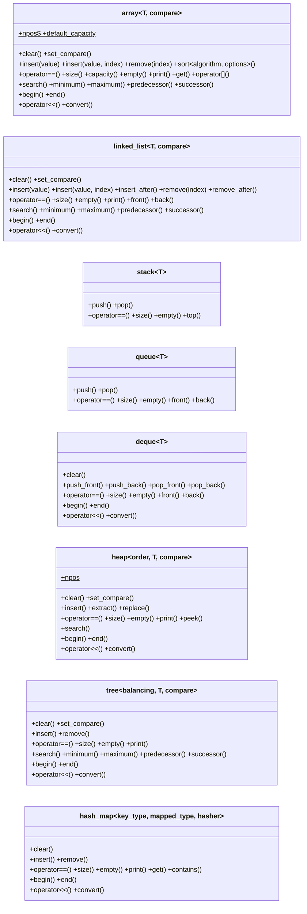
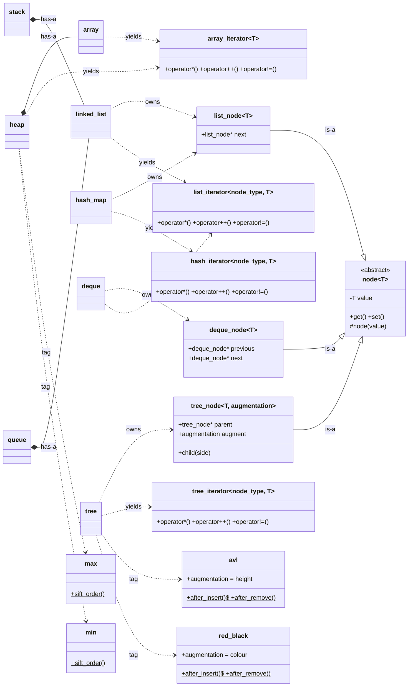
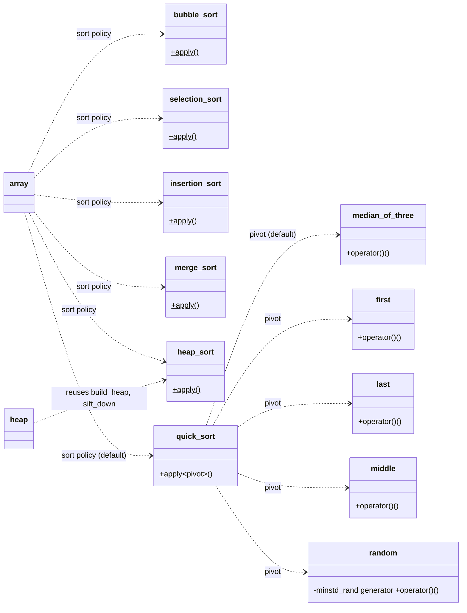

# Class Diagrams

Three diagrams. The first shows the public data structures and the interface each one exposes. The second shows the supporting classes (nodes, iterators) and the policy tags, with the inheritance-versus-composition decision recorded for every relationship. The third shows the sorting policies behind `array::sort`.

Public types live in the `ds` namespace under `lib/src/main/public/`. Supporting types live in `ds::detail` under `lib/src/main/public/detail/` and are never included directly by a consumer; the public headers pull them in. The policy tags (`max`, `min`, `avl`, `red_black`, the sorting algorithms and pivot strategies) and the exception types are in `ds`, because consumers name them, even though their headers are internal.

## Diagram 1: data structures and their interfaces

Each structure is an independent template. They share a method vocabulary by convention, not by a common base class (see Diagram 2 for why). A structure lists only the method families that apply to it. Every structure also has the rule of five (destructor, default, initializer-list, raw-buffer, copy and move constructors, copy and move assignment).

## Diagram 2: supporting classes and policies

Nodes, iterators, and the compile-time policy tags, with the relationship to each structure.

## Diagram 3: sorting policies

`array::sort<algorithm, options...>()` calls `algorithm::apply<options...>(values, size, comparator)`. Each tag forwards to a `ds::detail` function template over positional access, one algorithm per header in `sorting/`. Only `quick_sort` takes an option, the pivot strategy.

## Design decisions: inheritance vs composition

The original code expressed almost everything through inheritance, including a six-way abstract base (`data_structure`) and empty placeholder bases (`query_operations`, `specific_methods`). Each relationship is re-evaluated below. The rule applied: inheritance only for a genuine is-a that removes real duplication and is never on a hot copy path; composition otherwise; abstract base only when the shared code is behavior, not a name list.

### Nodes: inheritance (abstract base `node`)

- **Decision:** keep `node<T>` as an abstract base; `list_node`, `deque_node`, `tree_node` derive from it.
- **Why:** every node is-a value holder with links. The value field, `get`, and `set` are identical across all three; a base removes that duplication once. The subtypes differ only in link count and shape, which is exactly what subclassing expresses.
- **Abstract without a vtable:** the constructor and destructor are protected and non-virtual, so `node<T>` cannot be created on its own and nodes carry no vtable. The subtype is always known at the call site.

### Iterators: a shared concept, no inheritance

- **Decision:** no iterator base. Each iterator is a standalone type that satisfies the same informal concept: `operator*`, `operator++`, `operator!=`. A mutable iterator converts to its read-only counterpart.
- **Why:** iterators are copied and advanced in every loop iteration. A virtual base puts a vtable on that object and makes `operator++`/`operator*` indirect calls, which contradicts the speed-first goal and blocks inlining.
- **Shared code:** the generic linear queries (`find`, `first_extreme`, `closest_before`) are written once against the concept and serve the array (through raw pointers) and the linked list (through `list_iterator`).
- **Safety:** dereferencing or advancing an end iterator goes through `detail::fail_fast`, the single terminate path.

### Structure interface: convention, not a base class

- **Decision:** remove `data_structure` and the six method-family bases. The common method vocabulary is a documented convention (Diagram 1), not inheritance.
- **Why:** the structures are unrelated templates; nothing ever holds one through a base pointer, so the virtuals bought no polymorphism and cost a vtable on every container.

### Set operations (`integrates`, `eliminates`, `intersects`): removed

- **Decision:** drop the `instance_synergy` base and its operations entirely. They are not reimplemented in any form.

### stack / queue / heap: composition

- **Decision:** `stack` and `queue` each hold a `linked_list`; `heap` holds an `array`. They delegate and default their special members.
- **Why:** a stack is-not-a list; it restricts a list. Composition exposes only the narrowed interface and hides the rest.

### Heap and tree policies: compile-time tags, not inheritance

- **Decision:** `heap<order, T>` and `tree<balancing, T>` select behavior through a tag type resolved at compile time.
- **Heap:** the tag turns the comparator into the sift ordering (`max` keeps it, `min` reverses it), and the sift and build steps are the ones heap sort uses.
- **Tree:** the tag provides the node augmentation (height for `avl`, colour for `red_black`) and the `after_insert`/`after_remove` rebalance. The core reports each removal as the replacing child, its parent and the removed augmentation, which is all either policy needs.
